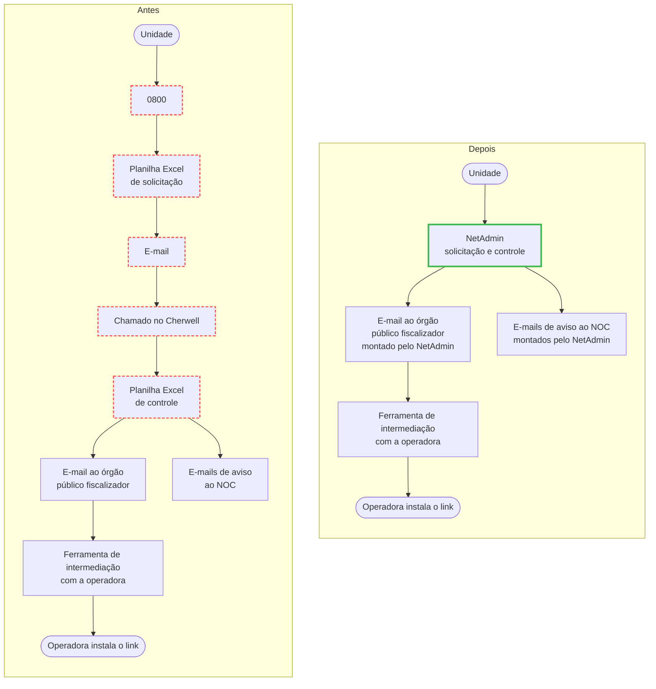
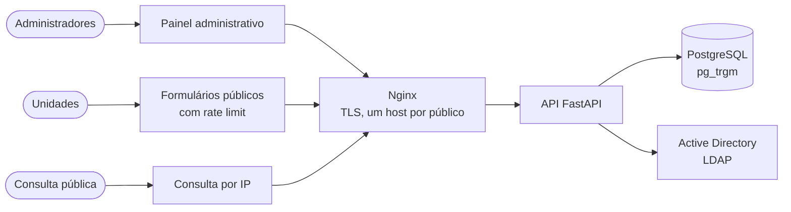
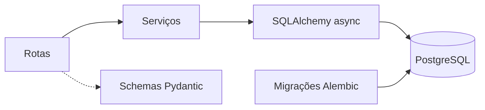

# NetAdmin – gestão dos links de intranet da PMESP

Sistema web que gerencia os links de intranet de cerca de 2.100 unidades da
Polícia Militar do Estado de São Paulo. Criei o sistema por iniciativa própria
na Seção de Redes. Em produção desde jul/2026.

> Sistema interno da PMESP: código, telas e dados são privados. Este repositório
> apresenta só o problema, a arquitetura e as decisões técnicas.

## O problema

Em vermelho tracejado, as etapas que o NetAdmin eliminou: o 0800, as planilhas
Excel, o e-mail da planilha e o chamado no Cherwell. O NetAdmin virou a fonte
única de dados das seções.

## Arquitetura

Três públicos num mesmo deploy, cada um com o próprio host no Nginx:

- **Painel administrativo:** cadastro e aprovação de solicitações, com login
  pelo Active Directory, tokens JWT e privilégios por pessoa validados no servidor.
- **Formulários públicos:** novo link, upgrade, mudança de endereço, desativação
  e atualização cadastral, com validações contra erro de digitação.
- **Consulta pública** por IP.
- Geração de modelos de e-mail a partir das solicitações.

## Backend em camadas

## Qualidade

- 257 testes automatizados (172 de backend, 85 de frontend), contagem de 2026-09-18.
- Lint sem avisos e CI no GitHub Actions.
- Deploy com Docker Compose e Nginx (HTTPS) em servidor Linux no data center da
  corporação, com operação por SSH.

## Stack

Python · FastAPI · SQLAlchemy (async) · Alembic · PostgreSQL · React 19 ·
TypeScript · Vite · styled-components · React Hook Form · Zod · Docker · Nginx ·
GitHub Actions · Linux

---

[Leonardo Richeto](https://github.com/Leonardo-Richeto) ·
[LinkedIn](https://www.linkedin.com/in/leonardo-richeto-183a37215)
